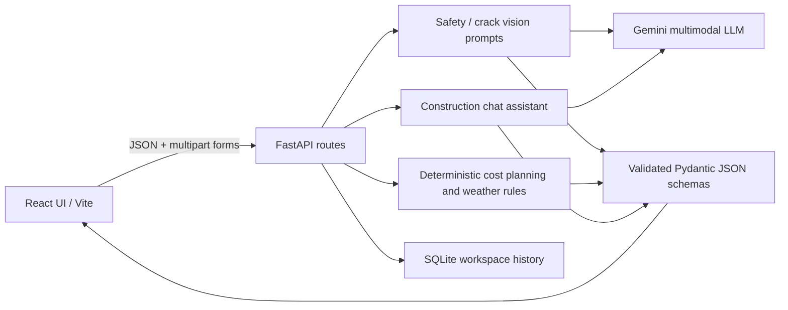

# Technical Architecture and Module Mapping

## System data flow



### Endpoints

| HTTP method | Path | Purpose | AI key needed? |
|---|---|---|---|
| GET | `/api/health` | Health and AI configuration status | No |
| POST | `/api/safety/analyze` | Multipart `file` + optional `notes` to generate PPE/hazard JSON | Yes, for real inference |
| POST | `/api/cracks/analyze` | Multipart `file` + optional `notes` for surface defect screening | Yes, for real inference |
| POST | `/api/planning/estimate` | Built-up area, building type, city tier, optional editable factors | No |
| POST | `/api/advisory/weather` | Selected condition → daily precautions | No |
| POST | `/api/assistant/chat` | Question + limited conversation history | Yes, for real inference |
| GET | `/api/history` | Recent workspace reports | No |

The frontend generates a random workspace UUID and sends it in the `X-Workspace-Key` request header. This prevents trivial accidental mixing of report histories but does not substitute for signed authentication.

### Core JSON example: Safety screening

```json
{
  "mode": "demo",
  "safety_score": 70,
  "overall_status": "Review required",
  "ppe_detection": [{"item": "Helmet", "status": "Unclear", "note": "DEMO DATA: no image analysis performed"}],
  "hazards": [{"hazard": "Example: housekeeping check", "severity": "Medium", "recommendation": "Inspect the site manually."}],
  "limitations": ["DEMONSTRATION ONLY: not inferred from the uploaded image."]
}
```

`mode` is either `ai` (a real provider response) or `demo` (explicitly fake illustrative data). The actual response can include more entries. `safety_score` is an uncalibrated screening indicator rather than a compliance score.

### Construction estimate calculation

```text
budget       = built_up_sqft × construction_rate_per_sqft
spent        = budget × completion_percent / 100
remaining    = budget − spent
market_value = built_up_sqft × user_supplied_market_rate_per_sqft
steel_kg     = built_up_sqft × steel_kg_per_sqft
cement_bags  = built_up_sqft × cement_bags_per_sqft
```

### Scope versus Skill Wallet project specification

- **Epic 1:** Environment and requirements — README, package.json, requirements.txt, `.env.example` and Dockerfile.
- **Epic 2:** Image modules — Safety & PPE Audit and Crack Diagnostics.
- **Epic 3:** Planning, material estimation, INR valuation, concept-art prompt and isometric visual.
- **Epic 4:** Multimodal AI layer and strict JSON contracts — `services/ai.py`, `schemas.py`, API validation.
- **Epic 5:** Weather advisory and multi-turn site assistant.
- **Epic 6:** Responsive UI, input validation, tests, cloud Docker/Render configuration, history and documentation.

### Safety-oriented design decisions

- **No raw image storage:** uploaded photos are only held in memory for inference and are discarded after the request.
- **Unobserved PPE is not automatically non-compliance:** the prompt asks for `Unclear` when visual evidence is insufficient.
- **Crack width stays null unless a calibrated reference is actually present.**
- **No invented real estate pricing:** user enters market and construction rates.
- **No invented real-time weather:** advisory responds to user-selected conditions only.
- **Provider calls are on the backend**, with `GEMINI_API_KEY` never sent to React.
